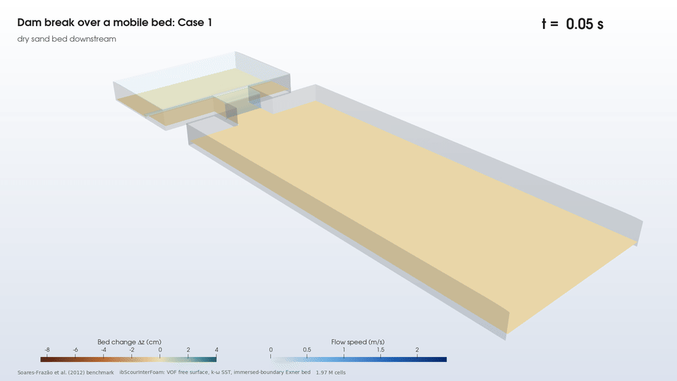
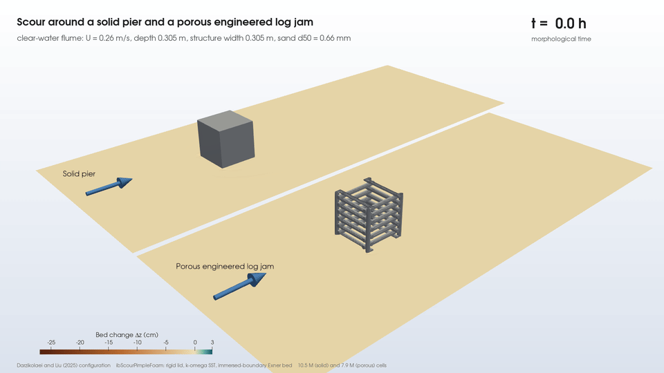

# ibScourFoam

Solvers and libraries for scour and sediment transport around structures with OpenFOAM. The bed is an immersed boundary on a fixed mesh, so the flow mesh does not deform as the bed evolves, and structures of any shape can be meshed independently of the bed. A body-fitted, deforming-bed option uses the same sediment model.

Dam break over a mobile bed (Soares-Frazão et al. 2012, Case 1; tutorial `damBreakMobileBed` on its fine mesh), computed with `ibScourInterFoam`:



Scour around a solid pier and a porous engineered log jam over 40 h of morphological time (the flume of Darzikolaei and Liu 2025), computed with `ibScourPimpleFoam`:



This is version 2. It replaces the original `ibScourFoam` solver (OpenFOAM v5.x / v2206), which remains available as release
[v1.0.0](https://github.com/psu-efd/ibScourFoam/releases/tag/v1.0.0).

## Solvers

| Solver | Purpose |
|---|---|
| `ibScourPimpleFoam` | single-phase flow (rigid lid) over an immersed mobile bed |
| `ibScourInterFoam` | two-phase flow with a free surface (VOF) over an immersed mobile bed: dam breaks, waves, open channels with wetting and drying |
| `suspendedSedimentFoam` | suspended sediment over a body-fitted bed (one grain size, one-way coupled) |

## Library `libibScour`

* **Immersed boundary.** Cut-cell (cut-face) treatment of a height-field bed on the floor patch of the mesh, with consistent cut-cell interpolation, wall-distance and pressure corrections; analytic and STL immersed solids (plane, cylinder, sphere, surface); balanced hydrostatics for still water.
* **Wall models.** Laminar, Spalding, rough log law and van Driest wall laws with the shear stress returned to the bed; k-omega SST wall treatment in immersed-boundary cells.
* **Bed model.** Exner equation on a finite-area mesh of the bed; bed load of Engelund-Fredsoe (with the slope-corrected critical Shields number of Roulund et al. 2005), Meyer-Peter-Mueller or van Rijn (1984); gravitational transport (Koch-Flokstra, Talmon); bed-load adaptation length; sand slide at the angle of repose; non-erodible floors; adaptive morphological factor; volume balance reported every step.
* **Suspended load.** Advection-diffusion of the concentration with settling, and bed exchange by a reference concentration (Zyserman-Fredsoe, van Rijn) in immersed-boundary cells (`libsuspendedSediment` for the body-fitted bed).
* **Body-fitted bed.** The `deformingBed` function object solves the same bed model on a wall patch of a deforming mesh (layered column motion), for comparison with the immersed bed.
* **Free surface.** Wave inlet/outlet condition for the volume fraction (`waveAlphaInletOutlet`).

## Requirements and build

* OpenFOAM v2606 (ESI/OpenCFD, www.openfoam.com), Linux.
* Python >= 3.8 with numpy for the case generators and checks of the tests and tutorials (matplotlib, vtk and scipy for some comparison scripts).
* `fsChannelIB` (tests) uses the open-channel boundary conditions of [openChannelVoF](https://github.com/psu-efd/openChannelVoF).

```bash
source <OpenFOAM v2606>/etc/bashrc
./Allwmake            # libraries into $FOAM_USER_LIBBIN, solvers into $FOAM_USER_APPBIN
```

## Tutorials

| Tutorial | Case |
|---|---|
| `tutorials/Roulund2005_pierIB` | live-bed scour at a vertical pier (Roulund et al. 2005), immersed bed |
| `tutorials/Roulund2005_pierBF` | the same pier with the body-fitted deforming bed |
| `tutorials/damBreakMobileBed` | dam break over a mobile bed, Case 1 and 2 of Soares-Frazao et al. (2012), free surface |

Each tutorial has a README with the set-up and its cost, and an `Allrun`.

## Tests

`tests/` holds small verification cases that run in minutes (channel flow over an immersed bed, sand slide, hump migration, pipeline scour, immersed versus body-fitted bed shear on slopes, suspended-load columns, free-surface cases). See `tests/README.md`; `tests/run_tests.sh` runs selected cases and collects their metrics.

## Citation

The immersed-boundary wall treatment of the original solver:

Y. Xu and X. Liu (2021). An immersed boundary method with y+-adaptation wall function for smooth wall shear. International Journal for Numerical Methods in Fluids. https://doi.org/10.1002/fld.4960

ibScourFoam and its applications:

Y. Song, Y. Xu, H. Ismail and X. Liu (2022). Scour modeling based on immersed boundary method: A pathway to practical use of three-dimensional scour models. Coastal Engineering, 171, 104037. https://doi.org/10.1016/j.coastaleng.2021.104037

Y. Song, S. Darzikolaei and X. Liu (2022). Scour around underwater unexploded ordnances (UXOs): An experimental and computational investigation. Ocean Engineering, 262, 112146. https://doi.org/10.1016/j.oceaneng.2022.112146

S. Darzikolaei and X. Liu (2025). Scour around porous and solid structures: Sediment transport, porosity effects, and semi-theoretical scour evolution model. Water Resources Research, 61(11), e2025WR040894. https://doi.org/10.1029/2025WR040894

A paper on the present version is in preparation.

## Disclaimer

This offering is not approved or endorsed by OpenCFD Limited, producer and distributor of the OpenFOAM software via www.openfoam.com, and owner of the OPENFOAM® and OpenCFD® trade marks.

## Authors

Xiaofeng Liu, Ph.D., P.E., and the Environmental Fluid Dynamics Group,
Department of Civil and Environmental Engineering, Penn State University.
Contributors to the original version are listed in the history of v1.0.0.

## License

GPL-3.0-or-later (see `LICENSE`).
